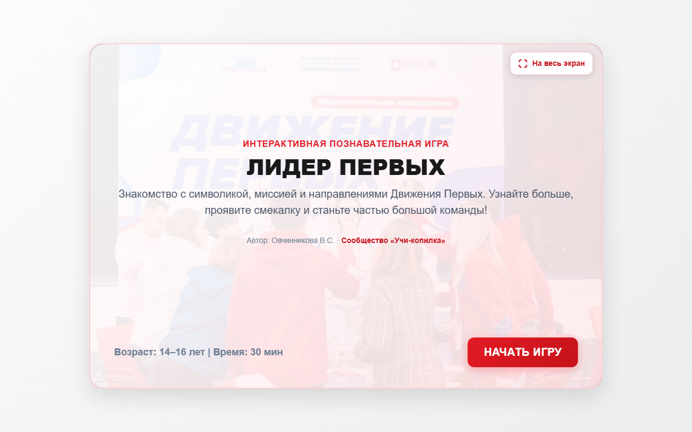
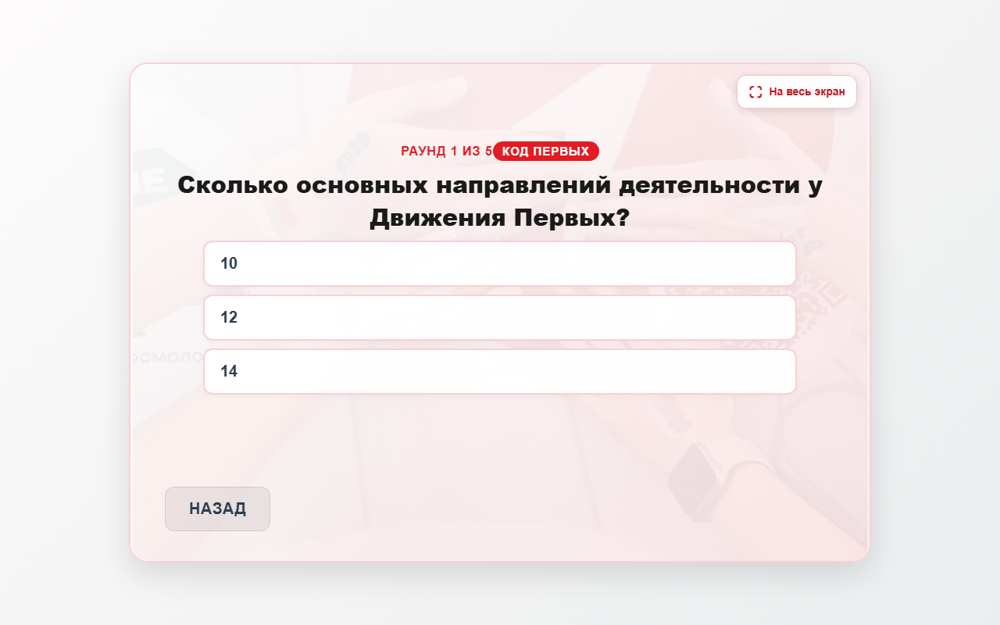
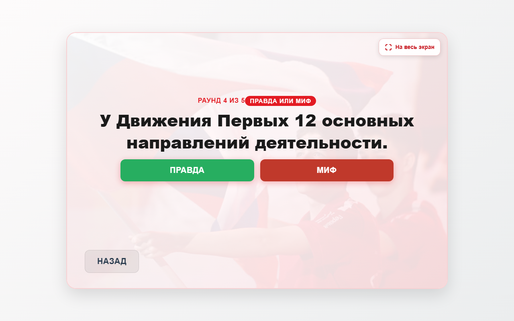
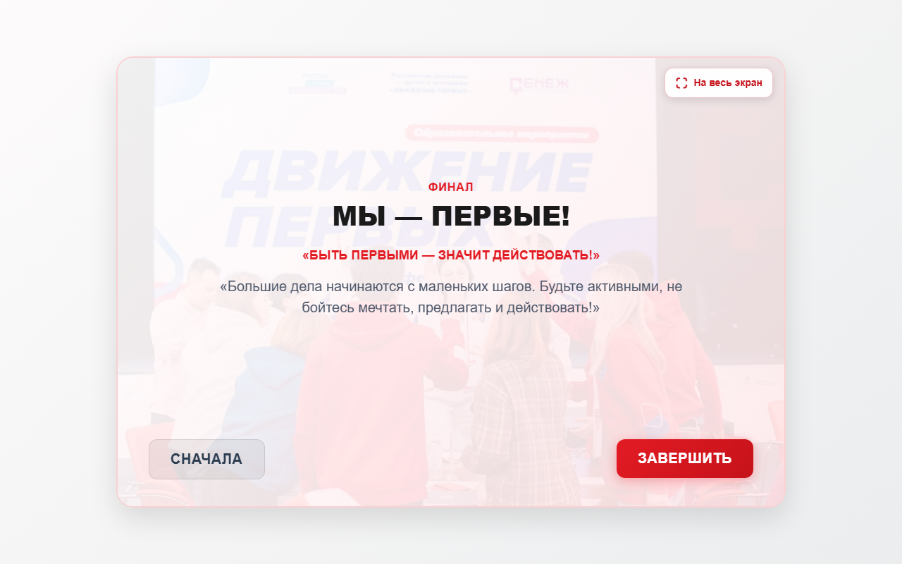
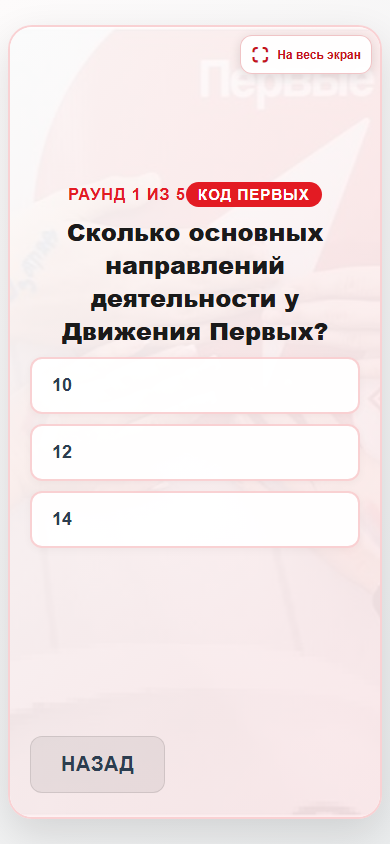

# 🔴 Лидер Первых — интерактивная познавательная игра

Игра-путешествие по миру **Движения Первых** для школьников 14–16 лет: символика и миссия,
12 направлений деятельности, «правда или миф» и творческое задание «Создаём событие Первых».
Пять раундов, около 30 минут, командный формат — без победителей и проигравших.

Всё приложение — один самодостаточный файл `index.html`: фоны встроены как data-URI,
внешних зависимостей нет. Достаточно открыть файл в браузере — интернет не нужен.

## 🌐 Демо

Играть онлайн: **https://yourskillsonline-code.github.io/lider-pervyh/**

## 🖼 Как это выглядит

| Приветствие | Раунд 1 |
| --- | --- |
|  |  |

| Раунд 4 | Финал |
| --- | --- |
|  |  |

На телефоне:



## 🎯 Раунды

1. **Код Первых** — 4 вопроса о символике, цветах, эмблеме и миссии Движения.
2. **12 направлений** — сопоставить девиз («Учись и познавай!», «Дерзай и открывай!»…) с направлением.
3. **Ситуации** — определить направление по описанию реального дела первичного отделения.
4. **Правда или миф** — 8 утверждений с объяснением правильного ответа.
5. **Лидер Первых** — творческое задание: придумать мероприятие для подростков
   (название, аудитория, три направления, польза).

## ✨ Особенности

- Мгновенная проверка ответа и подсветка верного варианта.
- Пояснения к каждому ответу — игра не только проверяет, но и учит.
- Кнопка **«На весь экран»** для показа на проекторе или интерактивной панели.
- Адаптивная вёрстка: планшет, телефон, большой экран.
- Полностью офлайн: один HTML-файл, без CDN и внешних картинок.

## 🚀 Как запустить

```bash
git clone https://github.com/yourskillsonline-code/lider-pervyh.git
cd lider-pervyh
```

Откройте `index.html` двойным щелчком — или запустите локальный сервер:

```bash
python -m http.server 8000
```

и перейдите на http://localhost:8000

Для занятия: разбейте класс на команды, выведите игру на экран и проходите раунды вместе,
обсуждая ответы. В пятом раунде команды презентуют свои идеи мероприятий.

## 🎓 Автор

**Овчинникова В.С.**

## 💬 Сообщество

ВКонтакте: [vk.ru/uchikopilka](https://vk.ru/uchikopilka) — сообщество «Учи-копилка»

## 📄 Использование

Материалы можно свободно использовать в образовательных и некоммерческих целях
со ссылкой на автора и сообщество. Логотип и символика Движения Первых принадлежат
их правообладателям.

---

© 2026 «Лидер Первых» — Овчинникова В.С.
